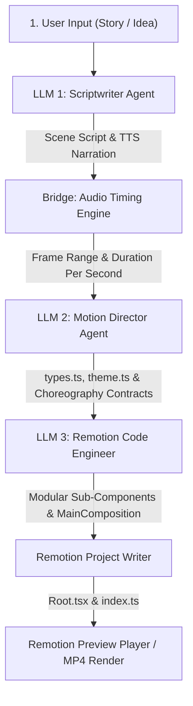

# Autonomous Motion Graphic Generator: 3-Stage Pipeline (LangChain.js + Remotion + MCP)

An Agentic AI project built with **Node.js (TypeScript)** and **LangChain.js** using a **3-Stage Modular Architecture (Story ➡️ Timeline ➡️ Remotion Code)** to automatically generate professional motion graphics videos synchronized with voiceover audio (TTS) while avoiding *spaghetti code*.

> **Showcase version note:** this repo demonstrates the engine architecture and code. The LLM prompts in `prompts/*.yml` are intentionally generic (not production-tuned prompts), and all data in the demos is fictional. LLMs are called directly via their native providers (Anthropic / Google / OpenAI / OpenRouter / Ollama).

---

## 🏛️ Modular Architecture (Clean Code & Separation of Concerns)

This project applies the **Single Responsibility Principle (SRP)**. Each stage is isolated in an independent module and exchanges data through strict Zod type contracts:

```
src/
├── types/                           # Pure data contracts (Domain Types & Zod Schemas)
│   ├── story.ts                     # Storyboard & scene script schema
│   ├── timeline.ts                  # Timing, frame range, and TTS audio schema
│   ├── director.ts                  # Keyframe choreography & component blueprint schema
│   └── code.ts                      # Generated file code schema
│
├── stages/                          # 3 Isolated Pipeline Execution Stages
│   ├── stage1-scriptwriter/         # [LLM 1] Storyboard & TTS Narration Script
│   │   ├── prompts.ts               # System prompt & writing rules
│   │   └── agent.ts                 # Scriptwriter Agent
│   │
│   ├── bridge/                      # [Bridge] Audio Timing & Frame Boundary Engine
│   │   └── timing.ts                # Word duration calculation (~2.4 words/sec) & frame conversion
│   │
│   ├── stage2-director/             # [LLM 2] Motion Director & Timeline Choreographer
│   │   ├── prompts.ts               # Visual direction & keyframe system prompt
│   │   └── agent.ts                 # Director Agent & TypeScript Contracts
│   │
│   └── stage3-coder/                # [LLM 3] Remotion React Code Engineer
│       ├── prompts.ts               # Remotion coding system prompt (spring, interpolate)
│       └── agent.ts                 # Coder Agent: Background, Scenes, & Master Composition
│
├── core/                            # Core Infrastructure
│   ├── llm/
│   │   └── provider.ts              # Model-Agnostic Factory (OpenAI, Gemini, Claude, Ollama)
│   └── mcp/
│       ├── client.ts                # @langchain/mcp-adapters Client
│       └── sample-server.ts         # Built-in stdio MCP server for design tokens
│
├── generator/                       # File I/O Operations (No LLM logic)
│   └── writer.ts                    # RemotionProjectWriter
│
├── orchestrator.ts                  # Pipeline Runner Facade (Connects Stages 1, 2, 3)
├── index.ts                         # Main local runner
├── cli.ts                           # Interactive CLI mode
├── demo.ts                          # Offline verification without API key
└── render.ts                        # Remotion render runner (MP4)
```

---

## 🔄 3-Stage Workflow



1. **Stage 1 (LLM 1 - Scriptwriter)**:  
   Takes a raw story and breaks it down into acts/scenes, voiceover narration scripts (TTS), and a list of required external tools (MCP).
2. **The Bridge (Audio Timing)**:  
   Calculates realistic speaking duration (conversational pace ~2.4 words/sec) and maps Remotion frame ranges for each scene (`startFrame` ➡️ `endFrame`).
3. **Stage 2 (LLM 2 - Motion Director)**:  
   Schedules internal animation actions (when text appears, when the camera zooms) precisely aligned to audio timing, and defines the `types.ts` and `constants/theme.ts` contracts.
4. **Stage 3 (LLM 3 - Remotion Code Engineer)**:  
   Writes React TypeScript code for each scene and composes them into `MainComposition.tsx` using `<Sequence from={...} durationInFrames={...}>`.

---

## 🚀 Running Locally

### 1. Configure Environment
```bash
cp .env.example .env
```
Fill in the API key for your chosen provider (Google Gemini, OpenAI, Anthropic, or Ollama).

### 2. Run the Generator
```bash
# Run with a custom story:
npm run start -- "Tell the story of software architecture evolution from monoliths to microservices and AI agents"

# Or interactive CLI mode:
npm run generate
```

### 3. Test Offline Without an API Key
```bash
npm run demo
```
This command immediately generates a modular 5-file project in the `output/` folder using the 3-stage architecture template.

### 4. Preview Video in the Browser (Remotion Player)
```bash
npm run preview
```
Open `http://localhost:3000` to scrub the timeline frame-by-frame.

### 5. Render Video to MP4
```bash
npm run render
```
The output video will automatically be rendered to `output/video.mp4`.

---

## 🎨 Style System & Auto Style Picker (Stage 0)

Users can pick a preset style, provide a free-form style description, or omit it completely:

```bash
npm run styles                                             # list all presets
npm run start -- "How AI agents write code" --style=neon-tech        # explicit preset (no LLM call)
npm run start -- "History of Majapahit" --style "documentary, muted gold"  # free-form -> LLM maps to closest preset + art direction
npm run start -- "5 tips for selling on TikTok Shop"                        # no style -> LLM auto-picks from topic
```

Presets: `viral-explainer`, `clean-editorial`, `neon-tech`, `playful-pop`, `soft-3d-story`, `chalk-classroom`, `minimal-mono`, `cinematic-epic` (defined in `src/styles/presets.ts`).
Each preset locks: allowed per-scene worlds, color palette, transitions, beat interval, camera intensity, SFX pack, music mood, and **one consistent narrator voice** for the entire video.
If the LLM style analyst fails, the pipeline falls back to keyword heuristics (never blocking).

## 🥁 Beat Engine (visual change ~ every 2 seconds)

1. **Beat Grid (Bridge)** — `src/stages/bridge/beat-grid.ts` creates beat slots roughly every `beatIntervalSec`, snapped to the most impactful words (phrase starts, numbers, content words). The hook scene gets tighter beats in the first 3 seconds.
2. **Director Beats (LLM 2)** — The Director must fill one beat per slot (`element-enter`, `counter`, `reveal`, `burst`, etc.) + sticker text + SFX.
3. **Beat Enforcer** — `src/stages/stage2-director/beat-enforcer.ts` locks frame math to audio, fills slots skipped by the LLM, removes overly tight beats, and closes gaps > 1.5× interval.
4. **BeatFX Layer (deterministic)** — `components/common/BeatFX.tsx` wraps every scene: punch-cut camera reframe, kick/shake on impact, flash, particles, sticker text, beat-accurate SFX, music bed, and progress bar. This keeps the video lively even if LLM-generated scene code is static.
5. **Coder (LLM 3)** — receives the Beat Schedule + `beatFrames()` and generic SceneCraft components: `KineticWords`, `StatCounter`, `IconPop`, `RevealList`, `SplitCompare`, `ParticleBurst`, `useBeat`.

### Audio library (optional)
```
library/
├── sfx/      whoosh.wav, pop.wav, click.wav, impact.wav, riser.wav, ding.wav, swoosh-soft.wav  (overrides synthesized SFX)
└── music/
    ├── upbeat/  chill/  epic/  tech/  playful/  emotional/   (place licensed .mp3/.wav files; selected by preset mood)
```
Without a library, SFX are synthesized automatically and the video renders without a music bed.

### Remix existing output without LLM cost
```bash
npm run remix                         # apply Beat Engine to existing output/ (heuristic style)
npm run remix -- --style=playful-pop  # also swap FX/palette preset
```

## 🧪 Cost-Saving Testing Modes (TTS)

```bash
npm run start -- "video topic" --tts=dummy   # silent WAV + estimated word timing: captions, beats, SFX & audio wiring still tested, 0 TTS cost
npm run start -- "video topic" --tts=skip    # no audio files at all (duration estimated from word count)
npm run start -- "video topic" --dummy-tts   # alias
TTS_MODE=dummy npm run generate              # via env (interactive CLI defaults to dummy)
```
Whenever `--tts` is not `real`, the Gemini TTS MCP server is not started at all.

## 🤖 Per-Stage Models

Each stage can be overridden via `.env` without editing YAML: `STAGE{0..3}_MODEL_PROVIDER` + `STAGE{0..3}_MODEL_NAME` (see `.env.example`).
If unset, Stages 0–2 use `DEFAULT_MODEL_*` and Stage 3 uses `google / gemini-3.1-flash-lite`.

## 🟨 Neo Brutalism Preset

`--style=neo-brutalism`: cream grid canvas, flat color blocks (yellow/pink/lime/blue), thick black outlines, hard blur-free shadows, `brutal-pill` captions. The `neo-brutal` world is available for `SceneBackdrop`, `ChapterBadge`, `SceneHeadline`, `IconPop`, `RevealList`, and `SplitCompare`.

## 🧾 `evidence-story` Preset ("proof/data" style)

Narration becomes a **word-by-word typed headline** (slab + yellow highlighter), evidence elements appear **on the exact spoken word**, accompanied by a fixed frame (chapter label, REC, handle pill) and a presenter avatar.

```bash
npm run start -- "this month's sales report" --style=evidence-story --avatar=my-presenter --handle=@yourhandle --assets ./evidence --tts=dummy
npm run demo:evidence && npm run preview:evidence      # offline demo without LLM
```

- **Word-anchored beats:** Director fills `anchorWord` per beat; the engine snaps the beat to that word's audio timing. In scene code, use `anchorFrame(scene, 'word')`.
- **Evidence kit (SceneCraft):** `EvidenceWindow`, `ChipGrid`/`DataChip`, `Stamp`, `TagLabel`, `InfoCard` (alertFrame), `StatusCard`, `RuledChart`, `StatCounter labelPosition="right"`.
- **New worlds:** `halftone-navy`, `paper-file`.
- **`--assets <folder>`:** images (real screenshots) → `USER_ASSETS['file-name.png']`; `facts.md`/`.txt` → the sole source of numbers/IPs/dates allowed to be displayed as evidence.

## 🧑‍🎤 Talking Presenter Avatar

1. Prepare poses (face **without a mouth**, consistent canvas & head position) + 1 sheet of 6 mouths (3x2 grid: rest, A, E, U, C, O) on a white background.
2. `pip install pillow numpy scipy` then run:
   ```bash
   npm run avatar:prepare -- --src "/path/to/folder" --id avatar-name
   ```
   Output: `library/avatar/avatar-name/` (transparent PNGs + sticker outline, `avatar.json`, `calibration.png`). Check `calibration.png`; if the mouth is misaligned, adjust `poses[].mouth.{x,y,width,rotate}` in `avatar.json`.
3. Pass `--avatar=avatar-name` (or `AVATAR_ID` in `.env`). You can also apply it to existing output: `npm run remix -- --avatar=avatar-name --handle=@you`.

Lip-sync: mouth shapes are derived from text (phonetic spelling) over word timings, then gated by actual WAV loudness (mouth closes during pauses). Poses are chosen by the Director per beat (`avatarPose`) + heuristics (question → thinking, surprising number → shocked, CTA → thumbs up), held for ≥ 1 second.

## 🧬 Style Genome — unique style per video (no preset)

Without `--style`, Stage 0 acts as an **Art Director**: designing *design tokens* from the topic (7-color palette, whitelisted font pair, backdrop recipe: gradient/pattern/texture/decor, shape language: radius/stroke/shadow/card, motion energy, caption & sticker style, layout). All components (`genome-base`/`genome-alt` backdrop, cards, captions, stickers, brand frame) read `TOKENS` from `constants/genome.ts`.

```bash
npm run start -- "coffee shop marketing tips"                                  # auto genome from topic
npm run start -- "coffee shop marketing tips" --style "70s retro newspaper"    # genome from free-form direction
npm run start -- "coffee shop marketing tips" --brand=library/brand/example-brand.json   # lock brand colors/fonts
npm run start -- "..." --seed=4821                                             # reproducible look
npm run start -- "..." --style=neo-brutalism                                   # presets still supported
npm run demo:genome -- --genome=kopi   # kopi | cyber | snack | stoic | mutated (same scene, different genome)
```

Deterministic guardrails:
- **Legibility:** WCAG contrast is auto-corrected; text ink is computed from background luminance; fonts are restricted to a verified whitelist.
- **Anti-repetition:** each look's fingerprint is saved in `library/style-history.json` (last 30) and passed to the LLM as "avoid looking like this". If the output is still too similar (similarity ≥ 0.6), the genome is mutated using the seed (hue shifted away from recent hues, font/pattern/decor/sticker swapped).
- **Brand kit:** locked colors and fonts are never altered by guardrails; all other elements are designed around them.

> For multi-user SaaS, move `style-history.json` to a database (per platform and/or per customer).

## 🔌 LLM Layer (polymorphic, native providers)

All stages call LLMs through a single `LlmClient.generateStructured()` interface (`src/llm/types.ts`). The factory (`src/llm/factory.ts`) instantiates a client from the model name, so stage code never needs to know which provider is used.

```env
STAGE1_MODEL=claude-sonnet-5-5   # optional; default is in prompts/stage1-scriptwriter.yml (model.name)
ANTHROPIC_API_KEY=...
```

| Model name | Provider |
|---|---|
| `claude-*` | Anthropic |
| `gemini-*` | Google |
| `gpt-*`, `o*` | OpenAI |
| `openrouter:<id>`, `ollama:<id>`, `custom:<id>` | forced via prefix |

- **Resolution order:** `STAGE{n}_MODEL` (`.env`) → `model.name` in the stage YAML → factory fallback. `max_tokens`, `temperature`, and `reasoning_effort` per stage live in YAML.
- **Structured output:** Zod schema → `withStructuredOutput` (LangChain), with per-call cost tracked in `CostTracker`.
- **Clear errors** when the provider API key for a stage's model is missing.
- Adding a new backend (e.g., an internal gateway) only requires a single new class implementing `LlmClient`.

| Stage | Default (`model.name`) |
|---|---|
| 0 Art Director | `gemini-3.8-flash` |
| 1 Scriptwriter | `claude-sonnet-5-5` |
| 2 Director | `gemini-3.8-flash` (reasoning high) |
| 3 Coder | `claude-sonnet-5-5` (`claude-opus-5-5` for showcase) |
